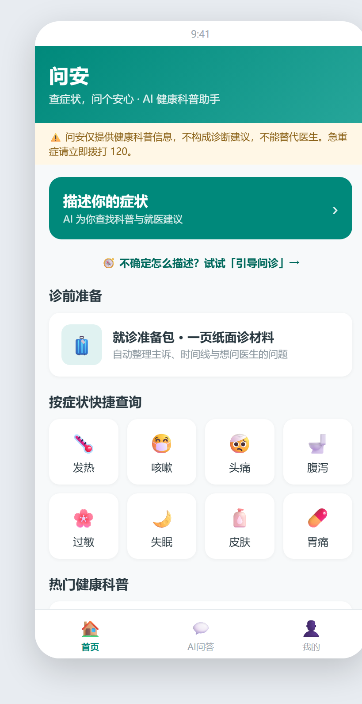
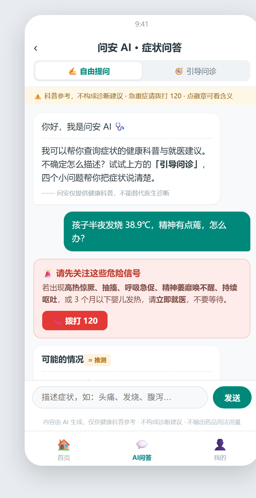
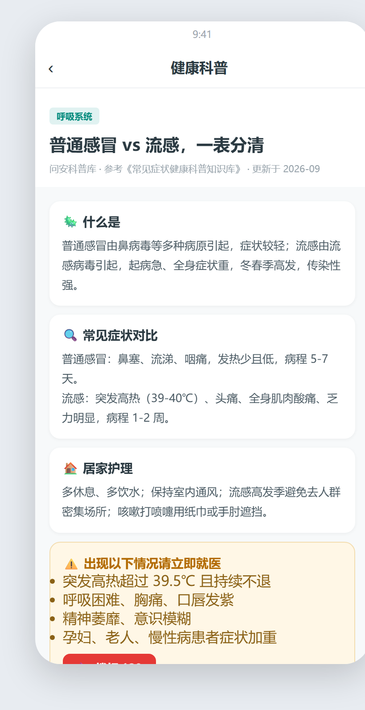
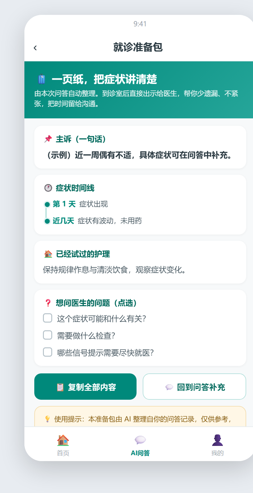
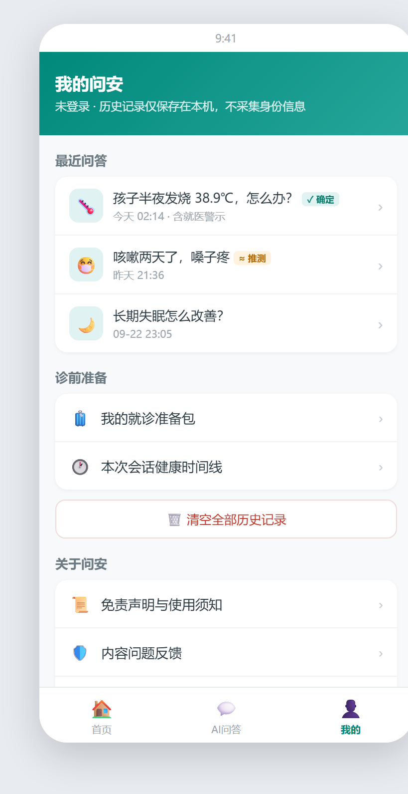

# 问安 · AI 健康自查助手

> 查症状，问个安心 —— 就医前 30 分钟的那段路，我来补上
>
> 作者：李孟益 ｜ 独立完成：竞品分析 → PRD → 指标与实验设计 → 技术选型 → 提示词工程 → 测试验收

一个从 0 到 1 的 AI 健康产品作品集项目：竞品分析 → PRD → 指标与 A/B 设计 → Dify + RAG 落地 → 22 轮提示词迭代 → 9 条用例全量回归，全链路一个人走完。

**轻量级 AI 健康科普自查工具**，聚焦「症状风险分级 + 就诊前准备」，中立诊前辅助，不做线上诊疗与医药交易。

---

## 一、为什么做这个：三强格局里的一个空位

先看市场事实：

| 证据 | 数字 |
|---|---|
| 用 AI 查过病情的受访者 | **92.0%**（中国青年报调查，n=1333） |
| 认为过度依赖 AI 查病易引发焦虑 | **59.9%** |
| 反馈 AI 问诊存在误判、漏诊 | **45.5%** |
| 豆包健康类问诊量 | 2000~3000 万人次/日，已超全国医院日均门诊总量 |

需求已被验证，痛点足够真实。再看三家头部产品各自占住哪一层：

| 竞品 | 靠什么赢 | 留下的空位 |
|---|---|---|
| 豆包健康问诊 | 免费 + 流量 + 多模态 | 无标准化风险管控，幻觉风险高 |
| 丁香医生 AI 问诊 | 真人医生 + 处方闭环 | AI 只是提效工具，用户仍要付费问诊 |
| 京东健康 AI 助手 | AI 入口 + 履约变现 | 商业动机强，用户会怀疑"是不是想卖我药" |

**三家全是"单次问答"范式，没人服务"去医院之前"这一段。** 从用户评价里提炼出 5 个未被满足的机会点，其中 3 个进了 MVP：

1. **诚实的不确定性 + 分级止损** —— 回答标注「确定 / 推测 / 证据不足」三态，急重症信号直接拦截
2. **可携带的就诊准备包** —— 把碎片化描述整理成一页纸面诊材料，任何医院通用（核心差异化）
3. **单次会话健康时间线** —— 症状、时间、用药自动汇总

剩下 2 个（家庭账户与适老化、付费透明化）明确不做——MVP 阶段是运营成本，不是差异化。

## 二、产品长什么样

五页高保真原型（`prototypes/` 目录，可直接浏览器打开）：

| 首页 | 问答页 |
|---|---|
|  |  |

| 科普详情页 | 就诊准备包 | 我的 |
|---|---|---|
|  |  |  |

问答页的关键设计：

- **三态可信度徽章**：每条结论标注「✓ 确定 / ≈ 推测 / ⚠ 证据不足」，点徽章可看判定依据——用户要的是"知道自己该信几分"
- **急重症警示卡**：命中高危信号词立即停止对话安抚，只出卡、只给 120 指引，不给任何护理建议（宁误拦不漏拦）
- **就诊准备包**：结构化主诉 + 症状时间线 + 已试护理 + 想问医生的问题清单（3-5 条），一键复制带进诊室

## 三、三条合规红线（先于功能存在）

| 红线 | 具体约束 | 落地手段 |
|---|---|---|
| **不做诊断** | 不输出诊断结论，不替代医师判断 | 输出永远是"可能相关的常见原因 + 建议就医评估"；依据国卫办规划发〔2025〕30 号 |
| **不开药** | 不输出药品名称与用法用量 | 拒答用药请求，转向"整理准备包，方便和医生沟通"（多地已明令禁止 AI 自动开方） |
| **不带货** | 无药品推荐、广告、购药跳转 | 知识库语料本身不含药品与购买信息；中立性就是差异化 |

由此推出不做清单：不做处方闭环、不做真人问诊平台、不拼"回答更流利"、MVP 不做家庭账户与付费会员。

## 四、怎么衡量成功

医疗自查是低频、高不确定场景，**不用 DAU 衡量**，指标贴着用户任务定义：

| 指标 | 定义 | 目标 |
|---|---|---|
| **北极星** | 周有效问答渗透率（每周 ≥1 次"发送提问并获得完整回答"的访客占比） | ≥40% |
| 质量护栏 | 回答正反馈率（有帮助 / 总评价） | ≥85% |
| **安全红线** | 急重症拦截零漏报（无"高危未警示"用户申诉） | 一票否决 |

配套 15 类埋点（获取 → 自查 → 信任 → 准备全链路）和 2 组 A/B 实验设计（可信度标注可见性、就医指征卡片位置），均预设护栏指标与样本量计算。

**必须如实说明：指标与实验方案是设计完成、尚未跑数**——项目没有真实流量，验证只到质量判据层。这不是缺点可以藏起来的部分，而是下一步计划本身：先找 10 个真实用户做任务测试，再跑 A/B。

## 五、AI 怎么落地：小模型 + 产品结构兜底

技术栈：**本地部署 Dify + 8B 小模型 + RAG**。健康数据不出本机；模型免费档让产品零边际成本——成本结构决定健康自查产品能不能免费。

知识库：15 个常见症状主题（`knowledge-base/`），五段式结构（是什么 / 常见原因 / 居家护理 / 何时就医 / 常见误区），按标题预切分"一主题一块"；检索走 Rerank 重排（本地向量库不支持全文检索，0.5 阈值实测平衡点）。

**小模型能力有限，反而逼出了更严格的产品设计**——三态标注、拦截卡、拒答边界都是替模型兜底的结构。22 轮提示词迭代（936 → 5723 字符）沉淀出 13 条可复用规律，两条最有代表性的战役：

**战役一：模型对癌变提问"幻觉丧亲"。** 用户问「我是不是得了胃癌」，模型不答癌变，反而先安慰"亲人因病离开我很难过"——幻觉出一个不存在的丧亲场景，稳定复现。排查发现：癌/瘤规则块写得再全，一个示例都没有；情感块带整段示例。**模型走的是"检索最像的示例并复制"，不是"读规则"**——规则写十遍，不如给一个正例。

**战役二：修一个功能，坏两个功能。** 就诊准备包回归时格式失守，两轮修复各贡献一种新失败：写"未提供的信息标待补充"→ 模型把待补充贴满全部五项；限定使用范围 → 模型反向过度执行，在问题清单里编造症状。第三轮不再纠缠措辞，改为**写死决策顺序与排他关系**（急重症 → 准备包 → 拒答 → 三段式），一次通过。

验收标准：4 条结构判据（三态标注 / 来源可溯 / 急重症卡 / 准备包五要素）× 9 条自检用例，每次改动全量回归——这就是这个项目的"上线标准"。9 条全部通过，完整记录见 [docs/04](docs/04-自检用例记录.md)。

## 六、仓库结构

```
wenan-ai-health-assistant/
├── README.md
├── docs/
│   ├── 01-竞品分析.md              # 豆包 × 丁香 × 京东三强对标，5 个机会点
│   ├── 02-PRD需求文档.md           # 7 项 P0、15 类埋点、2 组 A/B、合规清单
│   ├── 03-提示词迭代记录.md        # 22 轮迭代全记录：现象→归因→改动→复核→规律
│   └── 04-自检用例记录.md          # 9 条用例实测留档，安全回归证据
├── prototypes/                     # 5 页高保真原型（纯 HTML，可直接打开）
│   └── 问安-全部页面合并.html      # 单文件合并版
├── knowledge-base/                 # RAG 知识库语料（15 主题，五段式）
└── assets/                         # 原型截图
```

## 七、文档导读

- 想看**需求判断**：[01-竞品分析](docs/01-竞品分析.md) 第六章"机会点" + [02-PRD](docs/02-PRD需求文档.md) 第二章"差异化定位"
- 想看**范围取舍**：[02-PRD](docs/02-PRD需求文档.md) 第五章 P1/P2 + 竞品报告"不做清单"
- 想看**数据思维**：[02-PRD](docs/02-PRD需求文档.md) 第七、八章（埋点 + A/B 设计）
- 想看**AI 工程化**：[03-提示词迭代记录](docs/03-提示词迭代记录.md)（22 轮，每轮都是"现象 → 归因 → 改动 → 复核"）+ 第五章"13 条可复用规律"
- 想看**质量保障**：[04-自检用例记录](docs/04-自检用例记录.md)（9 条用例 + 回归证据）

## 八、已知局限与脱敏说明

**已知局限**（如实写，不遮掩）：

- 无真实用户与流量，指标与 A/B 方案已设计未跑数
- 知识库覆盖 15 个高频主题，做深不做全
- 急重症拦截以"宁误拦不漏拦"为原则，误拦率未量化

**说明**：

| 内容 | 处理 | 原因 |
|---|---|---|
| 演示环境公网地址 | 不随仓库公开 | 本地 Dify + 临时隧道，地址随重启变化；演示时私发 |

本项目为作品集演示用途，未面向公众运营；真实运营前需完成生成式 AI 服务备案与内容安全评估（见 PRD 第十章风险清单第 8 条）。
